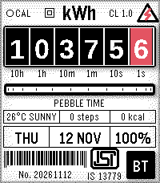
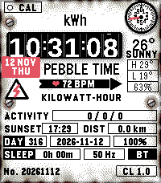
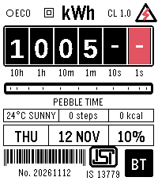
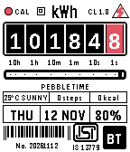
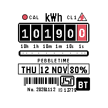
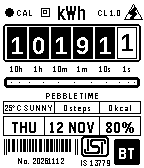

# Energy Meter

A Pebble watchface modelled on the single-phase electricity meters found in Indian homes. Time is read off a mechanical register, the meter disc turns with your activity, and the nameplate carries live data from the watch and phone.

<p align="center">
  
  &nbsp;
  
  &nbsp;
  
</p>

<p align="center">
  
  &nbsp;
  
  &nbsp;
  
</p>

## Features

| | |
|---|---|
| **Register** | Six drums read `HH MM SS`. Digits roll over like a mechanical counter; the seconds drum takes the accent colour. Follows the watch's 12/24 h setting. |
| **Disc** | Spins continuously in its slot. Speed scales with step rate and heart rate. |
| **CAL LED** | Pulses once per second, as on a static meter. |
| **Nameplate** | Weather, steps and active calories; day, date and battery level. |
| **Seal** | Shows `BT` when the phone is connected, `NC` with a double vibration when it drops. |
| **Details** | Hazard and Class II symbols, ISI mark, and a barcode and serial that change daily. |

## Meter styles

| Style | Description |
|---|---|
| Indian *(default)* | Clean static-meter nameplate with ISI mark, ratings row and rotating disc. |
| European | Weathered plate with screws and rust, a test dial whose needle follows the disc, a date sticker, heart rate in the rotation arrow, and rows for activity, sunset, distance, day of year and sleep. Weather adds daily high, low and humidity. |

The European style is available on rectangular watches; Pebble Time Round uses the Indian style.

## Battery saver

| Mode | Behaviour |
|---|---|
| Off | Full animation. |
| Auto *(default)* | Switches to saver when the battery falls below a set level (10–50 %) and is not charging. |
| Always | Saver at all times. |

In saver mode the face wakes once a minute instead of once a second. The seconds drums are parked, the disc steps once per minute, the LED is off and its label reads `ECO`. A wrist flick shows seconds for 30 seconds.

## Configuration

All options are available from the watchface settings in the Pebble app.

| Setting | Default |
|---|---|
| Meter style | Indian |
| Nameplate text | `PEBBLE TIME` |
| Ratings row | Live (weather / steps / kcal) or classic (240 V / 5-30 A / 50 Hz) |
| Disc speed follows activity | On |
| Smooth disc spin | On |
| Accent colour | Red |
| Temperature unit | °C |
| LED blink | On |
| Vibrate on disconnect | On |
| Battery saver | Auto, below 20 % |
| Shake to show seconds | On |

## Platforms

| Platform | Watch | Resolution |
|---|---|---|
| emery | Pebble Time 2 | 200 × 228 |
| basalt | Pebble Time, Time Steel | 144 × 168 |
| chalk | Pebble Time Round | 180 × 180 |
| diorite | Pebble 2 | 144 × 168 |

## Building

Requires the [Pebble SDK](https://developer.repebble.com/sdk/).

```sh
npm install
pebble build
pebble install --emulator emery
pebble install --phone <phone-ip>
```

## Project structure

```
src/c/main.c          watchface
src/pkjs/index.js     phone side: settings and weather
src/pkjs/config.js    settings page (Clay)
resources/            drum font, ISI mark and plate textures
```

## Credits

- Weather data from [Open-Meteo](https://open-meteo.com)
- Drum digits set in [Arimo](https://fonts.google.com/specimen/Arimo) (Apache 2.0)
- Settings page built with [Clay](https://github.com/pebble/clay)

## License

MIT
